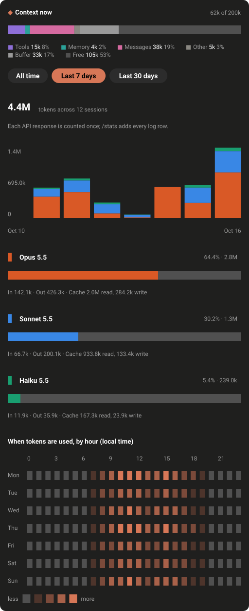

# claude-odometer

[](https://github.com/nxhung1610/claude-odometer/actions/workflows/test.yml)

A Claude Code mod that shows your account's 5-hour and 7-day usage limits and, in the terminal, the context window's fill, right above the prompt; and on the line above it the model answering, how fast it answers, and the session's cost. In the terminal the limits and the context sit in a card; in the desktop app the limits sit on the same line as the speed.


## What it shows

**Quota.** At the top of the card, under a `◆ quota` heading. In the terminal, one line gives each window a bar, its percentage, and `↻` with how long until its reset, like `6h 20m`, or `1d 21h` from a day away. In the desktop app, the windows sit on the speed row, side by side, each with its label, a solid bar, its percentage in bold, and its reset time; when the band is too narrow for both, the windows move to a row of their own. The desktop app shows the reset as a clock time: just the time if it is later today, otherwise the weekday and time. The bar is in the Claude colour, and the percentage takes the colour of its range: green under 70%, amber from 70%, red from 90%.

**Context.** In the terminal, below the quota row in the same card: the context window, with its header of tokens against the window, like `92k of 200k`, and the fill as a percentage, in the colour of its range: green under 70%, amber from 70%, red from 90%. Below it, the bar has a colour for each group in use (system, tools, memory and messages), a dim `░` for the buffer that auto-compaction keeps back, and a thin `─` for the free space, with the legend under the bar. Until the session's first response, and again after a compaction until the next one, the fill is worked out from the breakdown, so the parts show at once. With no breakdown yet, the header shows the window alone, and the bar says the parts appear after the first response. The band in the desktop app leaves the context out, since the desktop app has its own context panel. The `/tokens` pane still shows the context in use.

**Alerts.** When a limit or the context passes 90%, the mod raises one toast. A limit's toast says how long it has left at the pace it has been filling. The context's toast suggests `/compact`.

**Speed.** The row above the prompt shows the latest model step's TTFT (time to first output) and TPS (output tokens per second). While a step runs, it also shows how long the step has run, and a light moves across the word `working`. A sub-agent's steps are not timed, so the row shows the main conversation's model. The row starts with the session's model, as `/model` shows it, and follows `/model` within a second. Its effort comes from the latest model step, so after a change of model the old effort is left out until the new model's next step reports one; a change of effort alone shows at that step too, since the plugin API does not report the effort setting. On a wide band the row ends with the session's cost, as `/cost` totals it.


**`/tokens`.** A pane with tokens per day by model, for the last 7 days, the last 30 days, or all time. It reads your transcripts; the numbers in the image are example data. At the top, `Context now` names the context in use, by group. Below the chart, a heatmap shows when tokens were used, by weekday and hour, in local time. In the desktop app the chart and the heatmap are solid colour, the total is in large type, and each model has a bar of its share. In the terminal they are drawn in characters. The pane says when it was scanned, and `Refresh` scans the transcripts again. A scan reads only the transcripts that changed since the last one: the scanner keeps a cache in `.cache/usage.json`, in the plugin's folder.


## On the desktop app

The desktop app draws the band and the `/tokens` pane with its own elements, not characters. The terminal, VS Code and mobile draw them as text. These two images are drawn from the element tree the plugin gives the desktop surface, with example data. Their sizes and spacing are estimates, so the app's own rendering will differ.




## Install

In a terminal Claude Code session, version 2.1.275 or later, type:

```text
/plugin install odometer --marketplace nxhung1610/claude-odometer
```

Answer `y` to add the marketplace, then press Enter to take the default user scope. The mod is active in that session, and in each session you start after.

To run it from a clone, as you would while developing it:

```bash
git clone https://github.com/nxhung1610/claude-odometer.git
claude --plugin-dir /path/to/claude-odometer
```

`/tokens` runs `hooks/scan_usage.py` with Python 3, found as `python3` or `python` on your `PATH`.

## Development

```bash
claude plugin test        # run the test suite
claude plugin validate .  # check the manifest and hooks
tsc --noEmit --noUnusedLocals --noUnusedParameters -p tsconfig.json  # type-check, with TypeScript 5.9.3
python3 -m unittest discover -s hooks -p 'test_*.py'  # the transcript scanner's tests
node docs/gen-visuals.mjs                                # redraw the terminal illustrations
node docs/collect-desktop.mjs && node docs/render-desktop.mjs  # redraw the desktop images from the mod's trees
```

`.claude-plugin/types/` is generated by Claude Code when it loads the mod in a signed-in session, so it is not committed, and CI cannot type-check without it. `tsconfig.json` extends that folder, so load the mod once in a session (for example `claude --plugin-dir .`) before using `tsc` or the editor's checks.

The plugin is named `odometer` in `plugin.json`. The repository is `claude-odometer`, but a third-party plugin name cannot start with `claude-`. The state the mod keeps is stored under the plugin's name.

CI (`.github/workflows/test.yml`) runs the validation, the plugin tests and the scanner tests on Ubuntu, Windows and macOS, on pull requests and on pushes to `main`, with Claude Code 2.1.299. It also checks that `package.json` and `plugin.json` agree on the version, that the installer prints its command, and that the illustrations and the desktop images match the code they draw.

## How it works

- `session.start` reads the current rate-limit windows, the context fill with its breakdown, and the session's cost. It also clears the speed of any earlier session, and reads the session's model: that model is read again each second, so a change with `/model` shows at once.
- `session.end` cancels that timer, so a session that has ended reads nothing more.
- `session.measure` updates them when the engine reports a change in a window, in the context fill or in the cost. A change of the fill asks for the breakdown again, since a measure does not carry one. A limit or the context that passes 90% raises a toast.
- `ui.render` on `AbovePrompt` draws the model's speed on a row above the prompt, and below it a card with the quota and, in the terminal, the context window. On the desktop app `hooks/band.tsx` draws the speed and the quota on that one row, with no card; the terminal, VS Code and mobile draw the band in `hooks/terminal-band.tsx`. The band yields while a survey holds it.
- `turn.step` times each model step of the main conversation; a sub-agent's steps pass on untimed, since sub-agents can run alongside it and the row has one timing slot. It records the model and effort each one asked for. TTFT is the wait from the step's start to its first output: a chunk of text, thinking, a tool call, or its input. TPS is the step's output tokens per second from that output to its stop. While a step runs, the band redraws ten times a second: it shows how long the step has run, and a light moves across the word `working`.
- `/tokens` opens a pane with tokens per day by model, for the last 7 days, the last 30 days, or all time, with the context in use and the heatmap. On the desktop app `hooks/pane.tsx` draws the pane; the terminal, VS Code and mobile draw it in `hooks/terminal-pane.tsx`. It runs `hooks/scan_usage.py` with Python 3 over the transcripts in `$CLAUDE_CONFIG_DIR/projects`, or in `~/.claude/projects` when that variable is unset or empty. The script parses each transcript line, but keeps only each response's usage counts, model and timestamp. It prints the tokens per day by model and per local hour, and for each range how many sessions had usage in it, with a sub-agent's usage counted under the session that spawned it. It sends nothing anywhere. The scan keeps what it read of each transcript in `.cache/usage.json`, keyed by the transcript's size and modification time, so the next scan reads only what changed. A cache that is missing or unreadable only means every transcript is read.

## Files

- `.claude-plugin/`: `plugin.json`, and `marketplace.json`, which the install line above reads
- `bin/install.js`, `package.json`: an installer that runs the install line above through the Claude Code CLI, and its npm metadata
- `docs/*.svg`: the illustrations above; the numbers in the tokens pane are example data
- `docs/gen-visuals.mjs`: draws those illustrations, with `node docs/gen-visuals.mjs`
- `docs/desktop-band.json`, `docs/desktop-pane.json`: the element trees the desktop images are drawn from
- `docs/collect-desktop.mjs`: writes those two trees from the mod's test output, with `node docs/collect-desktop.mjs`
- `docs/render-desktop.mjs`: draws the desktop images from the trees, with `node docs/render-desktop.mjs`
- `hooks/register.tsx`: the hooks: session state, the model timer, the speed row's timing, the toasts, the `/tokens` scan, and which drawing each surface gets
- `hooks/terminal-band.tsx`: the band in the terminal, as text: the speed row, the quota, and the context card
- `hooks/terminal-pane.tsx`: the `/tokens` pane in the terminal, as text
- `hooks/band.tsx`: the band on the desktop app, with the speed and the quota on one row, the quota as solid bars
- `hooks/pane.tsx`: the `/tokens` pane on the desktop app, with solid columns, a bar per model, and the heatmap
- `hooks/alerts.ts`: the 90% toasts, and the time a limit has left at its pace
- `hooks/context.ts`: the groups of the context bar, its runs and the legend's lines, and the tokens pane's legend
- `hooks/timing.ts`: the speed row's text, the TTFT and TPS arithmetic, the step state, and the light's position
- `hooks/format.ts`: bar, tone, reset-label and time-left, token-count, cost and text-clipping helpers
- `hooks/tokens.ts`: the `/tokens` chart, heatmap and summary helpers
- `hooks/scan_usage.py`: counts tokens per day, model and local hour, and sessions per range, from the transcripts; with `--cache`, reads only the transcripts that changed
- `hooks/test-kit.ts`: the helpers the tests share: a fake engine, a fake model step, and the drawn trees
- `hooks/register.test.ts`, `hooks/terminal.test.ts`, `hooks/desktop.test.ts`: the tests of the state and the hooks, of the terminal, and of the desktop app; `hooks/illustrations.test.ts` pins the rules the illustrations copy; the other `hooks/*.test.ts` and `hooks/test_scan_usage.py` test their own modules
- `types/index.d.ts`: the quota, context, speed and token types, and the plugin state declaration

Tested with Claude Code 2.1.299.
