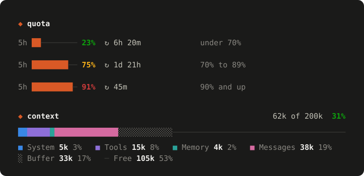
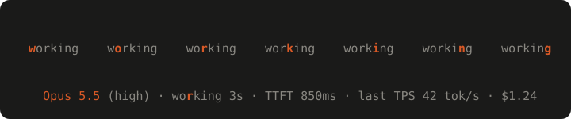
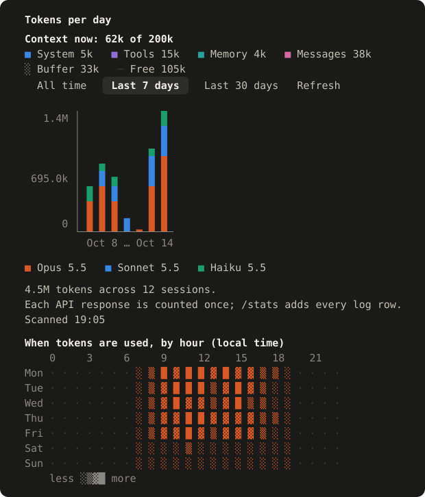

# claude-odometer

[](https://github.com/nxhung1610/claude-odometer/actions/workflows/test.yml)

A Claude Code mod that shows, right above the prompt, a card with your account's 5-hour and 7-day usage limits and the context window's fill, and on the line above it the model answering, how fast it answers, and the session's cost.



## What it shows

**Quota.** At the top of the card, under a `◆ quota` heading. In the terminal, one line gives each window a bar, a badge with its percentage, and `↻` with its reset time. In the desktop app, the windows sit side by side, each with a solid bar, its percentage in large type, and the reset time under the bar. The reset is just the time if it is later today, otherwise the weekday and time. The percentage is green under 70%, amber from 70%, red from 90%.

**Context.** Below the quota row, in the same card, the context window. Its header has the tokens against the window, like `92k of 200k`, and the fill as a percentage: green under 70%, amber from 70%, red from 90%. Below it, the bar has a colour for each group in use (system, tools, memory and messages), a buffer that auto-compaction keeps back, and the free space. In the terminal the bar is drawn in characters: a dim `░` for the buffer and a thin `─` for the free space. In the desktop app it is solid colour, with the buffer and the free space as lighter tracks. On both, the legend sits under the bar with each group's tokens and share, so nothing waits on a hover. The fill shows `—` until the session's first response, and again after a compaction until the next response.

**Alerts.** When a limit or the context passes 90%, the mod raises one toast. A limit's toast says how long it has left at the pace it has been filling. The context's toast suggests `/compact`.

**Speed.** The row above the card shows the latest model step's TTFT (time to first output) and TPS (output tokens per second). While a step runs, it also shows how long the step has run, and a light moves across the word `working`. A sub-agent's steps are not timed, so the row shows the main conversation's model. The row starts with that model and its effort, and on a wide band ends with the session's cost, as `/cost` totals it.



**`/tokens`.** A pane with tokens per day by model, for the last 7 days, the last 30 days, or all time. It reads your transcripts; the numbers in the image are example data. At the top, `Context now` names the context in use, by group. Below the chart, a heatmap shows when tokens were used, by weekday and hour, in local time. In the desktop app the chart and the heatmap are solid colour, the total is in large type, and each model has a bar of its share. In the terminal they are drawn in characters.



## Install

In a terminal Claude Code session, version 2.1.275 or later, type:

```text
/plugin install odometer --marketplace nxhung1610/claude-odometer
```

Answer `y` to add the marketplace, then press Enter to take the default user scope. The mod is active in that session, and in each session you start after.

To run it from a clone, as you would while developing it:

```bash
git clone https://github.com/nxhung1610/claude-odometer.git
claude --plugin-dir /path/to/claude-odometer
```

`/tokens` runs `hooks/scan_usage.py` with Python 3, found as `python3` or `python` on your `PATH`.

## Development

```bash
claude plugin test        # run the test suite
claude plugin validate .  # check the manifest and hooks
python3 -m unittest discover -s hooks -p 'test_*.py'  # the transcript scanner's tests
```

`.claude-plugin/types/` is generated by Claude Code when it loads the mod, so it is not committed. `tsconfig.json` extends that folder, so load the mod once in a session (for example `claude --plugin-dir .`) before using `tsc` or the editor's checks.

The plugin is named `odometer` in `plugin.json`. The repository is `claude-odometer`, but a third-party plugin name cannot start with `claude-`. The state the mod keeps is stored under the plugin's name.

CI (`.github/workflows/test.yml`) runs the validation, the plugin tests and the scanner tests on Ubuntu and Windows, on pull requests and on pushes to `main`, with Claude Code 2.1.299. It also checks that `package.json` and `plugin.json` agree on the version, that the installer prints its command, and that the illustrations match `docs/gen-visuals.mjs`.

## How it works

- `session.start` reads the current rate-limit windows, the context fill with its breakdown, and the session's cost. It also clears the model and speed of any earlier session.
- `session.measure` updates them when the engine reports a change in a window, in the context fill or in the cost. A change of the fill asks for the breakdown again, since a measure does not carry one. A limit or the context that passes 90% raises a toast.
- `ui.render` on `AbovePrompt` draws the model's speed on a row above the prompt, and below it a card with the quota and the context window. On the desktop app `hooks/band.tsx` draws the band; the terminal draws it in `hooks/register.tsx`. The band yields while a survey holds it.
- `turn.step` times each model step of the main conversation; a sub-agent's steps pass on untimed, since sub-agents can run alongside it and the row has one timing slot. It records the model and effort each one asked for. TTFT is the wait from the step's start to its first output: a chunk of text, thinking, a tool call, or its input. TPS is the step's output tokens per second from that output to its stop. While a step runs, the band redraws ten times a second: it shows how long the step has run, and a light moves across the word `working`.
- `/tokens` opens a pane with tokens per day by model, for the last 7 days, the last 30 days, or all time, with the context in use and the heatmap. On the desktop app `hooks/pane.tsx` draws the pane; the terminal draws it in `hooks/register.tsx`. It runs `hooks/scan_usage.py` with Python 3 over the transcripts in `$CLAUDE_CONFIG_DIR/projects`, or in `~/.claude/projects` when that variable is unset or empty. The script parses each transcript line, but keeps only each response's usage counts, model and timestamp. It prints the tokens per day by model and per local hour, and for each range how many sessions had usage in it, with a sub-agent's usage counted under the session that spawned it. It sends nothing anywhere.

## Files

- `.claude-plugin/`: `plugin.json`, and `marketplace.json`, which the install line above reads
- `bin/install.js`, `package.json`: an installer that runs the install line above through the Claude Code CLI, and its npm metadata
- `docs/*.svg`: the illustrations above; the numbers in the tokens chart are example data
- `docs/gen-visuals.mjs`: draws those illustrations, with `node docs/gen-visuals.mjs`
- `hooks/register.tsx`: hooks, the speed row and the card above the prompt with the quota and the context, the toasts, and the `/tokens` pane
- `hooks/band.tsx`: the band on the desktop app, with solid bars, the large percentages, and the legend under the context bar
- `hooks/pane.tsx`: the `/tokens` pane on the desktop app, with solid columns, a bar per model, and the heatmap
- `hooks/alerts.ts`: the 90% toasts, and the time a limit has left at its pace
- `hooks/context.ts`: the groups of the context bar, its runs and the legend's lines, and the tokens pane's legend
- `hooks/timing.ts`: the speed row's text, the TTFT and TPS arithmetic, the step state, and the light's position
- `hooks/format.ts`: bar, tone, reset-label, token-count, cost and text-clipping helpers
- `hooks/tokens.ts`: the `/tokens` chart, heatmap and summary helpers
- `hooks/scan_usage.py`: counts tokens per day, model and local hour, and sessions per range, from the transcripts
- `hooks/*.test.ts`, `hooks/test_scan_usage.py`: tests
- `types/index.d.ts`: the quota, context, speed and token types, and the plugin state declaration

Tested with Claude Code 2.1.299.
